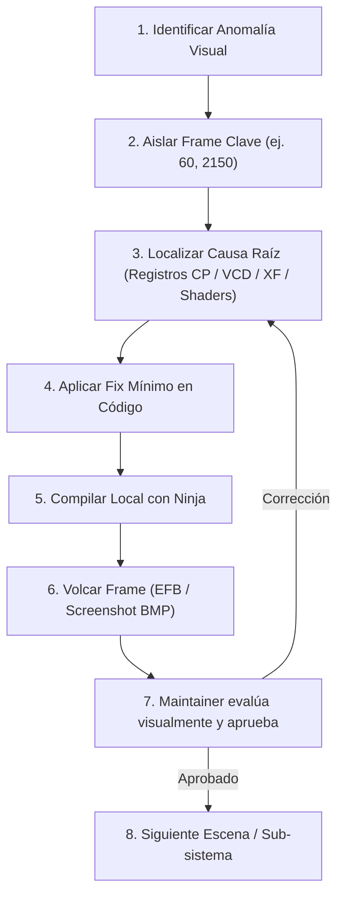

# Flujo de Trabajo con IA para la Recompilación Estática (GameCube / MGS:TTS)

Adaptado de `LostOdysseyRecomp` (`freefrank/LostOdysseyRecomp`).

## 1. Roles y Responsabilidades

| Rol | Responsabilidad | Lo que NO hace |
|---|---|---|
| **Maintainer (Usuario)** | Fija la dirección y toma decisiones. **Evalúa y juzga los problemas visuales a simple vista.** Prueba y aprueba entregables. | No hace micro-gestión técnica ni actúa como cuello de botella. |
| **Agente Principal (Antigravity)** | Comunica avances al Maintainer de forma concisa. Diagnostica causas raíz puntuales. Revisa diffs y evidencia visual (frames/EFB). Implementa fixes mínimos y compila. | No da vueltas innecesarias ni gasta tokens en teoría redundante o logs masivos. |
| **Subagentes / Tareas Aisladas** | Tareas largas o de exploración de símbolos/decompilaciones (`explorer`, `qa-tester`). | No toman decisiones de diseño ni modifican código fuera de alcance. |

> **Regla de Oro de Autoridad:**
> El Maintainer le otorga al Agente autonomía técnica para diagnosticar, modificar código local y compilar. El Agente se detiene a consultar únicamente en operaciones destructivas (git reset/clean, git push) o cuando se requiere validación visual por parte del Maintainer.

---

## 2. Principios Fundamentales

1. **Eficiencia en Runtime ante todo:**
   - No añadir abstracciones pesadas ni comprobaciones redundantes por frame.
   - Diagnosticar y resolver en la fuente (registros CP/BP/XF, matrices, pipelines de shaders, WGPIPE).
2. **Los valores predeterminados emulan el hardware original (GameCube / Gekko / Flipper):**
   - La resolución base es 640×480 EFB. Todo escalado o filtrado es secundario.
   - No tratar como bug comportamientos nativos de la consola (ej. cargas asíncronas de stage con EFB negro).
3. **Las conclusiones requieren evidencia empírica:**
   - Compilación exitosa $\ne$ Renderizado correcto.
   - Cada solución se valida con capturas de fotogramas clave (`efb_frame_X.bmp`, `screenshot_frame_X.bmp`) y mapas de píxeles reales.
4. **Validación Visual Guiada por el Maintainer:**
   - Detener en escenas/frames fijos.
   - Modificar una variable a la vez.
   - Indicar con claridad qué configuración está en pantalla y presentar el resultado visual para que el Maintainer juzgue a simple vista ("eye wins").
5. **Autolimitación estricta de tokens y concisión:**
   - Respuestas directas al Maintainer.
   - Prohibido volcar volcados de texto o logs de miles de líneas en el chat; la evidencia detallada reside en archivos locales (`scratch/`, `reports/`).

---

## 3. Ciclo de Trabajo: Del Problema al Release

### 3.1 Localización de Código y Causas Raíz
- Cada línea de código decompilado en C tiene su dirección PPC correspondiente.
- Rastrear registros de hardware GX usando `mem_read`/`mem_write` sobre `0xCC008000` (`WGPIPE`) y `__GXCurrentContext`.
- Examinar la pila PPC (`r1`, `lr`) para vincular draw calls con las rutinas de actores de `mgso.rel`.

### 3.2 Regla de Hooks
- Antes de añadir un hook nuevo en `host_call_hook`, comprobar si ya existe uno en la misma dirección o rango de funciones.
- Mantener los hooks HLE limpios, documentados y sin llamadas bloqueantes.

### 3.3 Validación y Cierre
- Comparar siempre el resultado visual contra el hardware real de GameCube (Dolphin de referencia).
- Registrar los hallazgos en `docs/` o `.agents/` para preservar el conocimiento del subsistema modificado.

---

## 4. Errores Comunes y Lecciones Aprendidas (GameCube Static Recomp)

### 4.1 GX y Pipeline de Vértices
- **Desincronización de VCD / Vertex Stride:** Si el descriptor de componentes de vértices (`VCD_LO` / `VCD_HI`) en ModernGekko no coincide exactamente con los bytes escritos por el juego en `WGPIPE`, el procesador de comandos consume menos (o más) bytes, provocando distorsión poligonal (ej. cuñas diagonales/triángulos recortados) y desalineación del stream FIFO.
- **Winding y Culling:** GameCube usa culling en `BP 0x00`. Si el viewport invierte el eje Y (`vp_ht_half < 0`), Front/Back culling se invierte.
- **Clip Control y Rango Z:** En GameCube, $Z_{clip}$ ya reside en $[0, 1]$. Invertir o negar $Z$ con `glClipControl(GL_ZERO_TO_ONE)` empuja los vértices fuera del volumen de recorte, produciendo cortes poligonales diagonales.

### 4.2 Cargas Asíncronas y DVDs
- `stage.dat` y `movie.dat` se cargan de forma asíncrona vía callbacks de DVD. El runtime debe completar las lecturas sin bloquear el hilo principal de renderizado.
